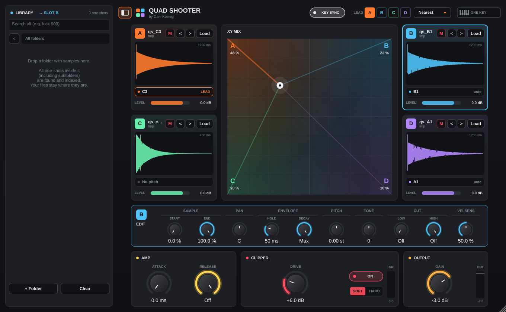

# Quad Shooter

Free 4-slot one-shot layering sampler for macOS (Apple Silicon), VST3 and Audio Unit.
By Dani Koenig. Sister plugin of [One Shooter](https://github.com/danikoenig/OneShooter).



## Features

- **4 sample slots A, B, C, D**, each with its own colour, waveform, Level and Mute
- **Edit row** for the selected slot (like XLN XO): Sample Start/End, Pan, Envelope Hold/Decay, Pitch, Tone, Cut Low/High, VelSens
- **XY Mix** in the middle: blend the four slots with one dot. Corner = one slot, centre = all four equal (equal power)
- **Pitch detection** on every sample. Claps, hats and noise are recognised as "no pitch"
- **Key Sync**: pick a lead slot, the other tonal slots are pitched to its note
  - *Nearest*: same note in the closest octave (keeps the character of each sample)
  - *Exact*: exactly the same note
  - Click the note under a waveform to set the root note by hand
- **Chromatic mode**: play all slots across the keyboard (C3 = original pitch), polyphonic
- **Amp**: Attack and Release for all slots (Release Off = pure one-shot)
- **Clipper** in the style of KNOCK (soft / hard, 4x oversampling), from One Shooter
- **Library**: drop a folder, all one-shots are indexed (files stay where they are). Click = listen, drag a sample onto a slot = load, double-click = load into the selected slot. Prev / Next per slot. Takes over the One Shooter index on first start.

## Install

Download the latest release: [Releases](https://github.com/danikoenig/QuadShooter/releases).
`QuadShooter-Installer.pkg` installs VST3 and AU. See [INSTALL.txt](INSTALL.txt).

## Build

```
cmake -B build -DCMAKE_BUILD_TYPE=Release -DCMAKE_OSX_ARCHITECTURES=arm64
cmake --build build --config Release --target QuadShooter_VST3 QuadShooter_AU
```

JUCE 8.0.4 is downloaded automatically. GitHub Actions builds every push on `main`; a tag `v*` creates a release.

Local engine test (pitch detection, Key Sync, XY Mix, state):

```
cmake -B build -DSHOOTER_TEST_SRC=tests/EngineTest.cpp
cmake --build build --target ShooterTest && ./build/ShooterTest
```
